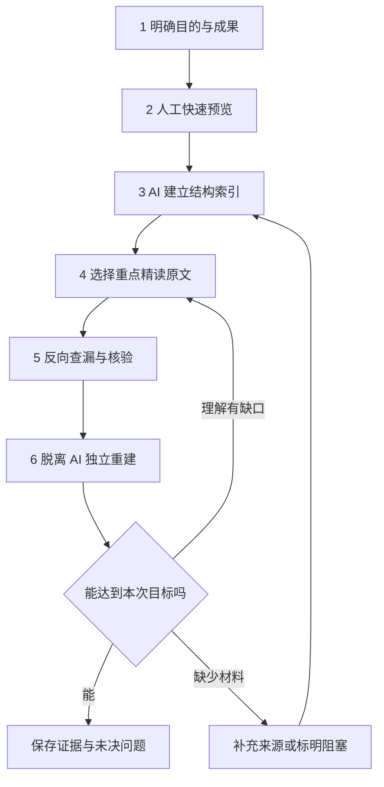

# AI 协同阅读：六步工作流

**依据：S001 第三部分及原提示词。** 六步顺序保留原讨论；输入输出、覆盖表、回退规则为编辑补充。它是可迭代的实践程序，不保证绝对完整。

## 流程总览

前三步减少无目的查找；第四、五步控制信息损失；第六步检验是否形成自己的理解。这是功能分工，不表示前几步不需要思考。

## 1. 明确阅读目的

**输入：** 文章、当前任务与已有知识。先写想回答的问题和完成后的行为；探索阅读允许目标暂时宽泛。

**解决的问题：** 没有目标就无法判断哪些细节重要。复现、判断和了解趋势所需的信息不同。

**产出：** 一句目标、初选层级、关键核验项。记录 AI 实际收到的材料范围：全文还是节选、图表是否可见、补充材料是否齐全。

**为何在这里：** 索引和摘要应围绕你的问题，而不是让模型默认的“重点”先决定阅读方向。

工具：[初步阅读](../../templates/reading/01-initial-orientation.md)。

## 2. 人工快速预览

自己先看标题、作者、日期、章节、主要图表和结论；记录初步印象与一两个疑问。新闻特别看出处和时间，论文特别看方法类别与图注。

**解决的问题：** 完全没有原文印象时，很难发现 AI 框架中的偏移。先预览是减少先入框架影响的实践建议，不声称能消除偏差。

**产出：** 简短手写地图与疑问，必要时修订目标。若只需低风险扫描，可以简化这一步；仍不要把未经核验的主张当成可靠事实。

## 3. 让 AI 建立可返回原文的索引

按原文章节列出问题、主张、证据、数据、假设、限制和所在位置。区分作者明确陈述、作者解释、AI 推断与外部背景。若文档无页码，用标题与段落起句定位。

**解决的问题：** 短摘要容易只剩结论；索引保留查找路径，使你能决定读哪里。

**产出：** 结构表与精读建议，以及不可读区域清单。先人工抽查关键位置是否存在。精确页码如果不真实，比没有页码更具误导性。

工具：[结构索引](../../templates/reading/02-structure-index.md)。

## 4. 有选择地精读原文

优先读与目标相关、自己不理解、证据承重或条件敏感的部分。让 AI 拆推导、解释术语、比较解释；每次解释后回到原文，检查是否引入了原文没有的假设。

**解决的问题：** 同时避免整篇重复加工和关键证据只听转述。你需要理解“为什么”，不仅记住“是什么”。

**产出：** 自己写的论证链、参数或条件表、仍不能解释的具体步骤。背景与重复部分可跳过，但需明确这是否影响任务覆盖。

工具：[重点段落分析](../../templates/reading/03-deep-analysis.md)、[论文阅读](../../templates/reading/06-research-paper.md)。

## 5. 反向遗漏检查

反向遗漏检查（Reverse Coverage Audit）是本讨论采用的操作名称，并非此处已核验的标准学术方法。输入应包括**原文、已有索引和你的笔记**，而不是只问 AI 对自己刚才的回答还有何补充。

逐章节检查关键数据、限定条件、例外、失败结果、作者承认的不足、正文与附件关系。对每个候选遗漏写出原文位置、可能改变哪项理解、是否与本次目标有关。

| 原文区域 | 笔记是否覆盖 | 是否人工核对 | 缺口与下一步 |
| --- | --- | --- | --- |
| 方法／关键图注 | 是／部分／否 | 是／否 | 补条件、修单位或回读 |
| 局限／反例 | 是／部分／否 | 是／否 | 降低结论范围 |
| 补充材料 | 可读／未取得／不可解析 | 范围 | 不能声称已覆盖 |

**解决的问题：** 已有笔记容易引导下一轮注意力，只重复已知重点。按原文区域核查可以暴露尚未覆盖部分，但仍可能漏掉未识别的关键条件。

**产出：** 已补充项、无关而暂略项、仍未核实项。不是让索引无限膨胀，也不是取得“全文完整”的保证书。

工具：[查漏](../../templates/reading/04-coverage-audit.md)、[核验规则](../shared/source-verification.md)。

## 6. 脱离 AI 独立重建

关闭回答和原文，先自己回答：解决什么问题？采用什么方法？证据如何支持结论？关键假设与局限是什么？根据目标再做推导、练习或新情境应用。

完成自己的回答后才重新打开原文或让 AI 指出缺口，依据原文纠错。知识尚不熟练并非失败信号，应把具体错误变成下一轮精读目标。重要内容可在稍后再次自测，但不规定未经验证的统一复习间隔。

**解决的问题：** 区分熟悉别人的叙述和能够自己调用知识；提取与自我解释研究提供相关启发，但不保证一次复述就掌握。

**产出：** 独立版本、纠错记录、一个迁移问题或实际任务，以及仍未完成项。

工具：[重建与自测](../../templates/reading/07-reconstruction-and-self-test.md)、[阅读笔记](../../templates/reading/reading-note.md)。

## 如何简化而不丢掉目的

扫描时保留目标、材料范围和必要核验，不必做全套笔记；分析阅读至少完成关键证据回读和一次独立复述；掌握或复现任务加入参数核查与实际操作。结束时记录“做到了什么、没做到什么”，而不是统一标成“读完”。
